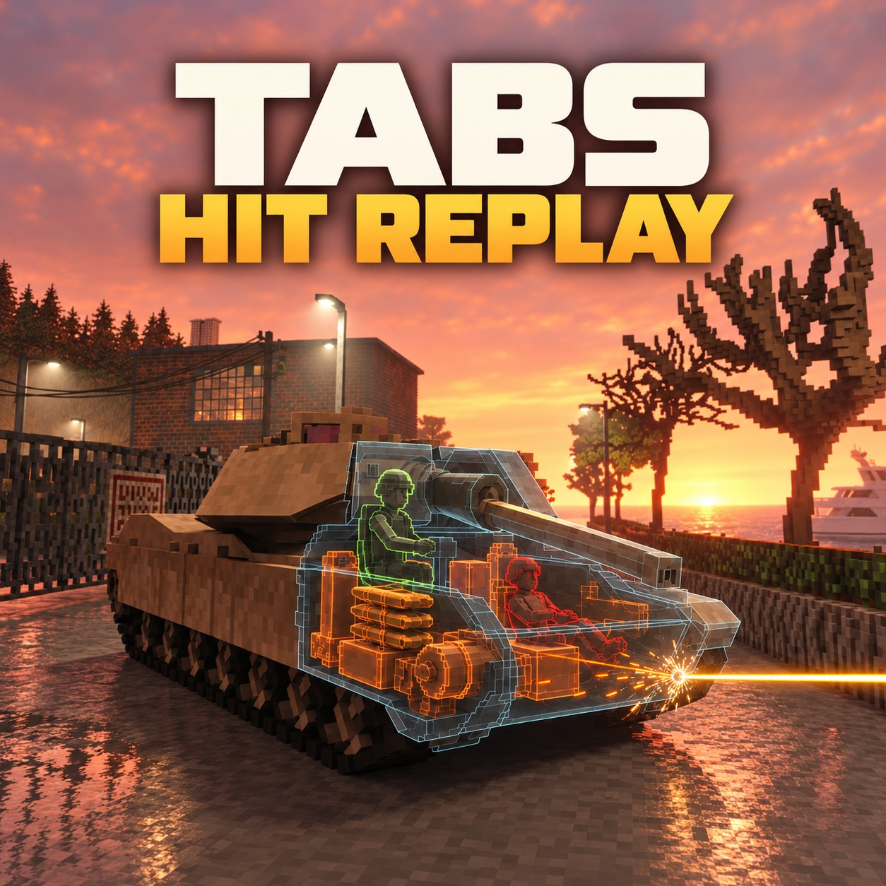

# TABS Hit Replay

By **Andrew**. An unofficial hit replay add-on for Teardown's TABS Vehicle Framework.



**Subscribing to TABS or installing this add-on alone is not sufficient: the matching bridge patch is required.**

[Download v0.1.0](https://github.com/swaggyp7/tabs-hit-replay/releases/tag/v0.1.0) · [Original TABS](https://steamcommunity.com/sharedfiles/filedetails/?id=3148138736) · [Optional TABS Crew](https://steamcommunity.com/sharedfiles/filedetails/?id=3561237115)

## 中文安装教程

### 下载内容

- `TABS-Hit-Replay-v0.1.0.zip`：独立回放 MOD。如果已订阅同一回放 MOD 的工坊版本，不要再启用一份本地副本。
- `TABS-Hit-Replay-Bridge-v0.1.0.zip`：TABS 桥接替换包，包含所有需要替换的文件，共两个。
- `SHA256SUMS.txt`：下载包校验值。

### 1. 安装独立回放 MOD

订阅原版 TABS Vehicle Framework 及其工坊页面要求的依赖。将独立回放 ZIP 解压到你的 `Documents/Teardown/mods` 文件夹。最终应存在 `Documents/Teardown/mods/tabs-hit-replay/info.txt`；不要多套一层同名文件夹。

### 2. 找到 TABS 框架目录

完全退出 Teardown。找到安装 Teardown 所在的 Steam 库（可能不在 C 盘），进入：

```text
<SteamLibrary>/steamapps/workshop/content/1167630/3148138736/
```

这是 TABS 框架目录，不是本回放 MOD 目录，也不是游戏主目录或 TABS 载具包目录。

### 3. 先核对版本并备份

本补丁只适配 `compatibility.json` 中 `original_sha256` 对应的两个原始文件，不能保证适配所有 TABS 更新。可在 PowerShell 中使用以下命令查看哈希（将路径换成你自己的）：

```powershell
Get-FileHash -Algorithm SHA256 -LiteralPath 'D:\SteamLibrary\steamapps\workshop\content\1167630\3148138736\main.lua'
Get-FileHash -Algorithm SHA256 -LiteralPath 'D:\SteamLibrary\steamapps\workshop\content\1167630\3148138736\TABS\scripts\ballistics.lua'
```

若两个值均匹配 `replacement_sha256`，说明已经装好该版补丁。若既不匹配原版，也不匹配补丁版，请停止替换：可能是 TABS 已更新或装有其他修改。

把原始 `main.lua` 与 `TABS/scripts/ballistics.lua` 备份到 TABS 目录之外，注明对应版本，并保留路径结构。不要用已打补丁的文件覆盖自己的原版备份。

### 4. 替换两个文件

解压桥接 ZIP，打开其中的 `replacement` 文件夹，把里面的 **main.lua 文件与 TABS 文件夹** 一起复制到上述 `3148138736` 目录，合并文件夹，并确认覆盖两个文件。不要把 `replacement` 文件夹本身直接放进去。

最终位置：

```text
3148138736/
├── main.lua                       ← 替换
└── TABS/
    └── scripts/
        └── ballistics.lua         ← 替换
```

桥接 ZIP 中的 README 和 compatibility.json 供查阅，不需要复制进 TABS。替换后可再次核对哈希，两个文件应匹配 `replacement_sha256`。

### 5. 启用和验证

启动游戏，在 Mod Manager 中启用原版 TABS 与 TABS Hit Replay，重新进入关卡。使用车载武器击中 TABS 车辆，确认出现回放；F9 可重播最近保存的片段。可选启用 TABS Crew 以显示乘员轮廓，无需修改 Crew 文件。

### 更新、冲突与卸载

Steam 更新 TABS 后可能覆盖桥接；先核对新版本是否兼容，再安装对应补丁。不要直接把本包反复覆盖到未知的新版本上。其他修改这两个文件的补丁可能冲突，不能靠先后覆盖来合并。

卸载时先退出游戏。仅当当前文件仍匹配本版 `replacement_sha256` 时，用同版原始备份恢复两个文件；然后禁用或删除独立回放 MOD。如果 TABS 已更新，不要恢复旧备份，应重新获取原版框架。

## English installation

1. Subscribe to [TABS Vehicle Framework](https://steamcommunity.com/sharedfiles/filedetails/?id=3148138736) and its required Workshop items.
2. Extract `TABS-Hit-Replay-v0.1.0.zip` into `Documents/Teardown/mods`. The resulting path must be `mods/tabs-hit-replay/info.txt`. Do not enable duplicate local and Workshop copies of this add-on.
3. Close Teardown. Locate `<SteamLibrary>/steamapps/workshop/content/1167630/3148138736/` in the Steam library holding Teardown.
4. Compare SHA-256 hashes of `main.lua` and `TABS/scripts/ballistics.lua` against `original_sha256` in `compatibility.json`. If they already match `replacement_sha256`, this bridge version is installed. Stop on any other hashes: your TABS version or another patch may be incompatible.
5. Back up both original files outside the Workshop folder, retaining their relative paths. Never overwrite an original backup with patched files.
6. Extract `TABS-Hit-Replay-Bridge-v0.1.0.zip`. Copy the **contents** of its `replacement` folder into `3148138736`, merging directories and replacing exactly the two files shown above. Do not copy the outer `replacement` folder itself. Verify the resulting hashes against `replacement_sha256`.
7. Start Teardown, enable TABS and TABS Hit Replay, and reload the level. Hit a TABS vehicle with a vehicle-mounted weapon to check the replay. TABS Crew is optional and requires no patch.

TABS updates can remove the bridge. Check compatibility before reapplying; never overwrite a newer unknown version with this package. Other patches editing the same files need manual integration. To uninstall, close the game and restore your matching original backups only if the current files still match this release's patched hashes. If TABS has updated, obtain a clean current framework instead of restoring stale backups. Disable/remove the replay add-on separately.

## Features and controls / 功能与操作

- Recent 3-second hit window with animated projectile and fragment paths; F9 replays the saved window.
- Fixed vehicle framing, internal module status colors, and optional detailed Crew outlines (green alive / red dead).
- F8: toggle replay; F9: replay; F10: switch own-vehicle / nearby-vehicle target mode. Nearby mode has no distance filter, but only simulated hits reaching the bridge can be recorded.
- Vehicle-mounted small-caliber rounds are supported. Standalone handheld weapon shots are **not** currently recorded.
- This is a wireframe replay overlay. Cover artwork is promotional and is not an exact in-game screenshot of the overlay.
- Capture is bounded; very dense fire can reach capacity limits. Crew status uses observed damage/connection state, not an exact per-limb death event.

## Bridge scope and compatibility

The bridge appends recording code to TABS `main.lua` and adds six guarded hook sites in `TABS/scripts/ballistics.lua` for impact, penetration and fragment association. It does not intentionally change native damage formulas or handheld weapon scripts. It requires the exact original file hashes in `compatibility.json`; no universal compatibility is claimed. This release has local scripted verification, not exhaustive compatibility testing on other installations.

## Credits and third-party files

Replay add-on author: **Andrew**. TABS Vehicle Framework belongs to its original creators; see the linked Workshop page for credits. Optional TABS Crew belongs to its respective creators. This is an unofficial project and does not claim endorsement.

The bridge replacement ZIP contains modified TABS source files, which remain third-party material. No blanket license or redistribution permission for TABS is granted by this repository. The TABS page states “DO NOT REUPLOAD WITHOUT PERMISSION”; this README does not represent proof of permission. Crew assets are not included.
